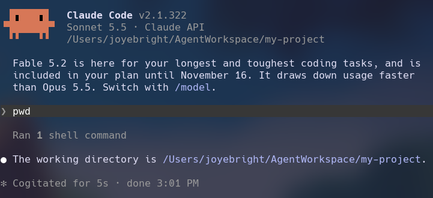

Hi,

In this post, I would like to quickly show you how to encapsulate your AI agents using sandboxes in Docker.

The main reason that I encapsulate AI agents is that I want them to only live within an isolated environment (i.e., sandboxes) so that I have more control over what they can access and whether I am okay with certain permissions. This is more about protecting your (confidential) information, which might be indirectly exposed while working with AI agents.

It’s good to note that harnesses offer sandboxes themselves, but this is my least preferred way to encapsulate an AI agent. I guess you can think of the reason behind it.

Anyway, I use [Docker Sandboxes](https://docs.docker.com/ai/sandboxes/) to encapsulate my AI agents, i.e., to containerize my agents.

We use local sandboxes for this setup. To get it to work, we need to first install the `sbx` CLI. You can find the installation steps here:

https://docs.docker.com/ai/sandboxes/install/

Docker Sandboxes currently supports well-known agents such as Claude Code, Codex, Copilot, etc. See the full list here: https://docs.docker.com/ai/sandboxes/agents/

> 💡 I recommend creating a specific workspace somewhere on your system for your future projects. e.g., `~/AgentWorkspace`.

Once you’ve installed `sbx`, sign in your Docker account using the `sbx login` command. This will open a browser to authenticate with Docker. Next, we need to authenticate our agent. In this demo, we use Claude Code. We then create a new project inside our workspace, e.g., `~/AgentWorkspace/my-project`, and launch Claude Code in the sandbox by linking it to our project directory. Like this:

```bash
sbx run --name my-sandbox claude ~/AgentWorkspace/my-project
```

> Tip: You can view all the flags used for `sbx` using `sbx --help`.

The command above runs a Claude agent inside an isolated environment named `my-sandbox`, with access to the working directory `~/AgentWorkspace/my-project`. To double-check Claude’s current working directory, run `pwd`. You should see the directory assigned to the agent. Now you can comfortably share the documents you want to share with the agent with peace of mind that you have more control over which local files the agent can access.



You can check out the [Docker Sandboxes usage documentation](https://docs.docker.com/ai/sandboxes/) to learn more about managing your sandboxes using `sbx`.

Meanwhile, here are some commands I commonly use:

```bash
# List all your sandboxes
sbx ls

# Stop your sandbox
sbx stop my-sandbox

# Start your sandbox again
sbx run --name my-sandbox

# Remove your sandbox
sbx rm my-sandbox

# Get help for a specific command
sbx run --help
```
